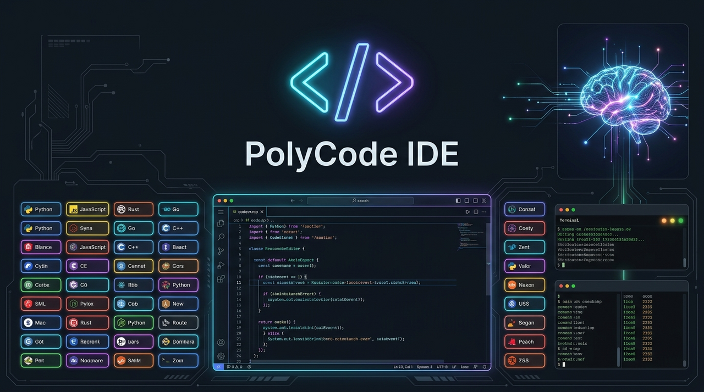
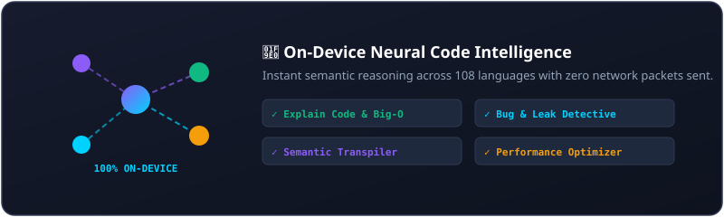

<div align="center">



# ⚡ PolyCode IDE

### Offline Compiler & On-Device AI Coding Assistant for 100+ Languages

[](https://developer.android.com)
[](#-supported-languages--technologies)
[](#-offline-compiler-architecture)
[](#-on-device-ai-assistant)
[](LICENSE)

<br/>

**PolyCode IDE** turns your Android device into a complete, zero-latency coding powerhouse. Compile, execute, simulate, and debug code across **108 programming languages, web technologies, and esoteric machines**—completely offline with zero remote server dependency.

</div>

---

## 🎬 Live Interactive Animations & Demos

### 1. Animated Code Execution & Real-Time Terminal

<div align="center">
  
</div>

<br/>

### 2. Multi-Engine Offline Compiler in Action

From algorithmic sorting in **Python** to native **SQLite queries** and **Brainfuck virtual machine** execution:

<div align="center">
  
</div>

<br/>

### 3. On-Device AI Coding Assistant

<div align="center">
  
</div>

<br/>

<div align="center">
  
</div>

---

## 🚀 Key Features

### 💻 1. True Offline Multi-Engine Architecture
No internet connection? In airplane mode? In remote areas? PolyCode runs locally:
- **Embedded JavaScript & TypeScript Engine:** Native V8 JS evaluation directly on the device with console interceptors (`console.log`, `console.error`) and return value inspect.
- **Live Isolated Web Sandbox:** Interactive visual rendering of **HTML5, CSS3, Canvas 2D, SVG graphics, Tailwind CSS, and Markdown**.
- **Real Native SQLite Engine:** Runs queries directly against an in-memory Android SQLite database with formatted tabular data grids.
- **Turing-Complete Brainfuck VM:** 30,000-cell byte tape, pointer tracking, and loop matching.
- **Symbolic Lisp / Scheme Evaluator:** Nested S-expression parser supporting arithmetic, recursion, and lambdas.
- **Regular Expressions (Regex) Compiler:** Regex compiling with group extraction and pattern analysis.
- **Universal Static AST Simulator:** Lexical analysis, bracket balance detection, cyclomatic complexity estimation, and instruction step simulation for systems & scripting languages (Python, C, C++, Rust, Go, Java, Kotlin, Swift, C#, etc.).

---

### 🧠 2. On-Device AI Coding Assistant
An intelligent developer copilot that lives entirely inside your phone:
- **Code Explanation:** Deconstructs syntax, logic paths, and computes estimated **Big-O Time & Space Complexity**.
- **Bug & Memory Leak Detective:** Static analysis for unclosed brackets, infinite loops, division by zero, and unhandled null hazards.
- **Performance Optimizer:** Recommends cache-friendly structures, SIMD iteration, and idiomatic efficiency upgrades.
- **Semantic Code Transpiler:** Translates algorithms between languages (e.g. Python ↔ JavaScript ↔ Kotlin ↔ Rust ↔ C++).
- **One-Tap "Apply to Editor":** Insert generated algorithms straight into your active code canvas.

---

### 🎨 3. Modern Cyber-Developer IDE Experience
- **Line Numbers Gutter & Monospace Typography**
- **Mobile Quick-Accessory Bar:** Instant one-tap access to `{ } ( ) [ ] < > ; -> => = $ # ! *` and `TAB`.
- **Tabbed Results Terminal:**
  - `Console Output`: Colored stdout, stderr, execution time (ms), and memory (KB).
  - `Web Preview`: Live responsive rendering with touch events.
  - `SQL Table`: Formatted column headers and alternating row shading.
  - `AST & Specs`: Token counts, cyclomatic complexity, and target specifications.
- **Built-in Snippet Manager:** Save custom scripts locally and access preset algorithmic templates.
- **Offline Language Encyclopedia:** Syntax cheat sheets and reserved keywords for all 108 languages.

---

## 🌐 Supported Languages & Technologies

PolyCode IDE includes built-in configurations, syntax specs, and execution runtimes for **108 programming languages**:

| Category | Languages Included | Execution Runtime |
|:---|:---|:---|
| **⭐ Popular** | Python, JavaScript (ES6+), TypeScript, C, C++, Java, Kotlin, Rust, Go, C#, Swift, Ruby, PHP, Dart, Scala, Groovy, Pascal, Crystal, Ballerina, Solidity, Vyper, Move | Native JS / AST Sandbox / EVM |
| **🌐 Web & Frontend** | HTML5, CSS3, Canvas 2D, SVG, Three.js WebGL, React JSX, Vue SFC, Svelte, Tailwind CSS, Bootstrap 5, Sass/SCSS, LESS, Pug, Elm, PureScript, WebAssembly (WAT) | Live Web Preview Sandbox |
| **⚙️ Systems & Hardware**| Assembly (x86_64), Assembly (ARM64), MIPS, RISC-V, Zig, Nim, V, D, Fortran, COBOL, Ada, VHDL, Verilog, GLSL (OpenGL), WGSL (WebGPU), Forth, Chapel, Modula-2, Oberon | Native AST & VM Simulator |
| **📱 Mobile & Modern** | Kotlin, Swift, Dart (Flutter), React Native TSX, Q# (Quantum) | AST Sandbox |
| **📊 Data, SQL & AI** | SQL (SQLite), R, Julia, GNU Octave / MATLAB, Gnuplot, Graphviz DOT, Cypher (Neo4j), PL/SQL, T-SQL, SPARQL, Solr, APL, J, K/q | Native SQLite / Data Engine |
| **📜 Scripting & Shell** | Bash / Shell, PowerShell, Lua, Perl, Tcl, AWK, sed, Pike, REXX | Sandbox Interpreter |
| **λ Functional & Logic** | Haskell, Elixir, Clojure, OCaml, F#, Erlang, Common Lisp, Scheme, Racket, Prolog, Idris, Agda, Coq, Standard ML, ReasonML, Io | Lisp Evaluator / AST Sandbox |
| **🎮 Esoteric & Fun** | Brainfuck, Befunge-93, LOLCODE, Whitespace, COW, Malbolge, Ook!, ArnoldC | Turing-Complete VM |
| **📑 Config & Markup** | Markdown, LaTeX, JSON, YAML, XML, TOML, GraphQL, Protocol Buffers (Protobuf), Dhall, Jsonnet, CUE, KDL | Live Renderer / Syntax Engine |

---

## 🏗️ Project Architecture

PolyCode IDE is engineered using **Modern Android Clean Architecture**, **Jetpack Compose (Material 3)**, and **Kotlin Coroutines**:

```
app/src/main/java/com/example/
├── MainActivity.kt                  # Edge-to-edge entry point
├── PolyCodeApp.kt
├── catalog/
│   └── LanguageCatalog.kt           # 108+ language definitions, cheat sheets & algorithms
├── engine/
│   └── OfflineCompilerEngine.kt     # Multi-engine execution (V8 JS, Web, SQLite, BF, Lisp, AST)
├── ai/
│   └── OfflineAiEngine.kt           # On-device semantic AI code analysis & transpiler
├── model/
│   └── LanguageInfo.kt              # Domain models (ExecutionResult, LanguageDefinition, etc.)
├── viewmodel/
│   └── PolyCodeViewModel.kt         # Reactive state flow & coroutine orchestration
└── ui/
    ├── PolyCodeScreen.kt            # Primary developer workspace
    ├── components/
    │   ├── CodeEditorView.kt        # Editor with line numbers & quick symbol bar
    │   ├── TerminalView.kt          # Multi-tab terminal (Console, Web, SQL, AST)
    │   ├── LanguagePickerSheet.kt   # Searchable 108-language picker with category chips
    │   ├── OfflineAiSheet.kt        # Conversational AI assistant drawer
    │   ├── CheatSheetDialog.kt      # Offline syntax cheat sheets
    │   └── SnippetsDialog.kt        # Local snippet storage & template loader
    └── theme/
        ├── Color.kt                 # Cyber-developer high-contrast palette
        ├── Theme.kt                 # Material 3 dark IDE theme
        └── Type.kt                  # Typography definitions
```

---

## 🛠️ Building & Running Locally

### Prerequisites
- **Android Studio Ladybug (2024.2+)** or command-line Gradle
- **Android SDK 36** (Min SDK: Android 7.0 / API 24)
- **JDK 17+**

### Quick Build Commands
```bash
# Clone the repository
git clone https://github.com/your-username/polycode-ide.git
cd polycode-ide

# Run unit tests
gradle :app:testDebugUnitTest

# Assemble Debug APK
gradle :app:assembleDebug

# Install APK directly on connected Android device / emulator
adb install -r app/build/outputs/apk/debug/app-debug.apk
```

---

## 🔒 Privacy & Permissions

- **Zero Data Collection:** PolyCode IDE does not transmit your source code, algorithms, or chat messages to any remote server.
- **Zero Account Gate:** No registration or login required.
- **Minimal Permissions:** Only uses system resources for on-device compilation and local preview.

---

## 📄 License

This project is licensed under the [MIT License](LICENSE).

---

<div align="center">
  <sub>Built with ❤️ for developers who code everywhere, from subways to airplanes and off-grid workspaces.</sub>
</div>
